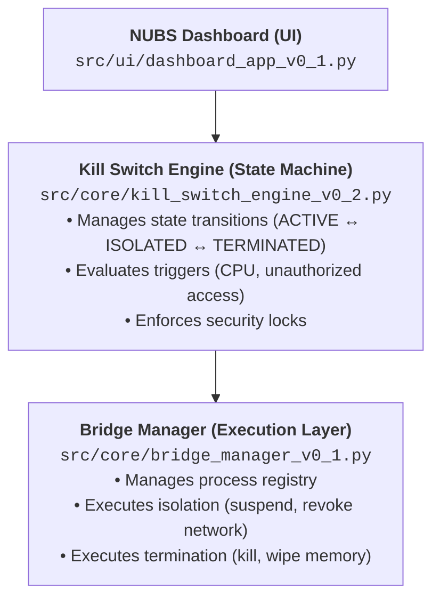

## NUBS: Normal Users Bridge-Switch
AI Personal Kill Switch – Monitor, Bridge, and Safely Terminate AI Processes
[Python 3.8+](https://img.shields.io/badge/python-3.8+-blue.svg)](https://www.python.org/downloads/)
[License: MIT](https://img.shields.io/badge/License-MIT-yellow.svg)](https://opensource.org/licenses/MIT)

## Overview
NUBS (Normal Users Bridge-Switch) is a lightweight, Python-based system designed to give normal users absolute control over AI processes. It provides a "bridge" to safely interact with AI systems while maintaining a "kill switch" that can instantly isolate or terminate processes in response to resource spikes, security breaches, or manual overrides.

## Key Features
**Three-State Safety Model:**
|ACTIVE🟢| ISOLATED🟡|TERMINATED🔴|
| --- | --- | --- |
Automatic Triggers: CPU monitoring and unauthorized access detection
Manual Overrides: Admin dashboard for real-time control
One-Way Termination: Once killed, the system requires a full restart (security guarantee)
Lightweight: No heavy dependencies, runs on standard Python

## Architecture


## Project Structure
```
NUBS/
├── src/
│ ├── core/
│ │ ├── kill_switch_engine_v0_2.py # State machine & trigger logic
│ │ └── bridge_manager_v0_1.py # Process execution layer
│ └── ui/
│ └── dashboard_app_v0_1.py # Streamlit dashboard
├── tests/
│ ├── test_core_v0_1.py # Unit tests (9 tests)
│ └── test_e2e_v0_1.py # End-to-end workflow test
├── docs/
│ ├── phase_2_core # Core logic documentation
│ ├── phase_3_ui # UI documentation
│ └── phase_4_testing # Testing & security docs
├── scripts # Deployment scripts (Phase 5)
├── HANDOFF.md # Project handoff tracker
└── README.md # This file
```

## Quick Start
**Prerequisites**
- Python 3.8 or higher
- pip (Python package manager)

**Installation**

 1. Clone the repository:
```
git clone https://github.com/hughbreant/NUBS.git
cd NUBS
```
2. Install dependencies:
```
pip install streamlit
```

**Running the Dashboard**

Launch the NUBS dashboard:
```
streamlit run src/ui/dashboard_app_v0_1.py
```

_The dashboard will open in your browser at http://localhost:8501_

## Usage Guide
**Understanding the States**
| State | Indicator | Description | User Action |
| --- | --- | --- | --- |
| ACTIVE | 🟢 | Normal operation. Bridge is open, all processes running. | Monitor system |
| ISOLATED | 🟡 | Sandboxed. Network revoked, processes suspended. | Review logs, perform admin recovery |
| TERMINATED | 🔴 | Hard kill. Processes terminated, memory wiped. | Restart application |


## Dashboard Controls
The dashboard provides three manual control buttons:

*Simulate CPU Spike (>90%): Triggers automatic isolation (useful for testing).

*Simulate Security Breach: Triggers immediate termination (useful for testing).

*Manual Admin Recovery: Restores the system from ISOLATED to ACTIVE (only available when isolated).

_Note: All controls are disabled when the system is TERMINATED._

## Testing
Run Unit Tests

python tests/test_core_v0_1.py

Expected output: 9 tests passing

Run End-to-End Test

python tests/test_e2e_v0_1.py

_Expected output: 1 comprehensive workflow test passing_

## Security Considerations
Current Security Guarantees
- One-Way Termination: Once TERMINATED, the system cannot be recovered without a full restart.
- Process Isolation: All managed processes are immediately suspended or killed on state transition.
- Trigger Safety: No triggers can affect a terminated system.

## Future Security Enhancements
- Add user authentication to the dashboard.
- Implement persistent audit logging.
- Add post-termination registration locks.
- Implement rate limiting on trigger evaluations.
  
 _For detailed security analysis, see docs\phase_4_testing\security_review_v0_1.md_

## Documentation
Core Logic: docs\phase_2_core\core_logic_spec_v0_1.md

Bridge Manager: docs\phase_2_core\bridge_manager_spec_v0_1.md

Dashboard UI: docs\phase_3_ui\dashboard_spec_v0_1.md

Testing: docs\phase_4_testing\e2e_testing_spec_v0_1.md

Security: docs\phase_4_testing\security_review_v0_1.md

## Contributing
This project follows a strict session-based workflow. See HANDOFF\_v0\_8.md for the current project status and next steps.

## License
This project is licensed under the MIT License - see the LICENSE file for details.

## Acknowledgments
Built for normal users who want control over their AI systems.

Current Version: v0.8 (Phase 4 Complete)

Last Updated: November 20, 2026
